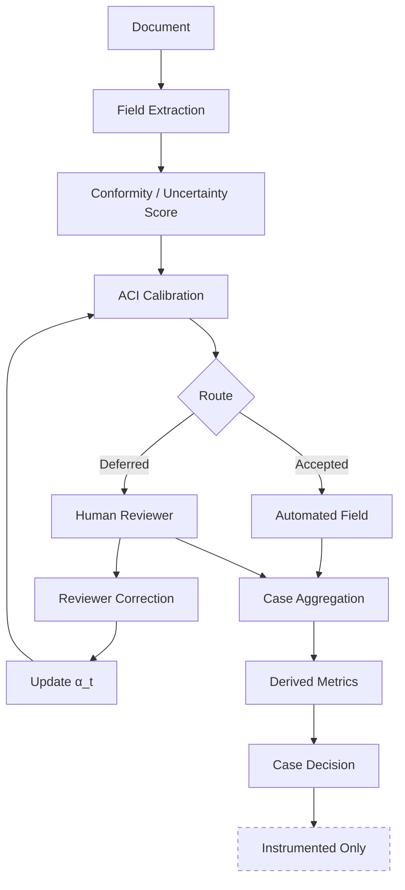
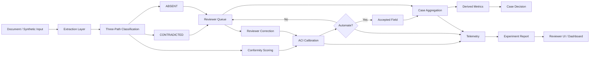

# Verdict

### A credit-underwriting decision layer that only rules when it has earned the right to.

**Calibrated field-level abstention under distribution shift.**  
Verdict estimates, *before making a decision*, which extracted fields can be safely automated and which should be deferred to human review.

The contribution is deliberately narrow and falsifiable:

> **Can the system automate useful work while keeping realized marginal miscoverage at or below a target α, even when document archetypes and industries appear that were absent from training?**

[](https://verdict-bice.vercel.app/)
[](#reproduce-it)
[](#reproduce-it)
[](#two-loops)

## Live Demo

**Try Verdict here:**  
### [verdict-bice.vercel.app](https://verdict-bice.vercel.app/)

The deployed application includes the reviewer workflow, uncertainty states, experiment results, documentation, and a live `/api/analyze` path.

> **Important demo limitation:** uploaded document contents are currently **not parsed**. The file is hashed into a deterministic seed that drives the existing synthetic field model. The real abstention, routing, ACI thresholding, and judgment pipeline run afterward. Files are processed in memory and are not written to disk or logged.

---

## Why Verdict exists

Traditional confidence-threshold systems often reduce uncertainty to something like:

```text
confidence > 0.90 → automate
confidence <= 0.90 → review
```

That looks reasonable, but the threshold itself may not provide the risk control you think it does.

Verdict instead treats automation as a **selective prediction problem**:

```text
Extract
   ↓
Estimate uncertainty
   ↓
Calibrate
   ↓
Can this field be trusted?
   ↓
 ┌───────────────┬─────────────────┐
 │      YES      │       NO        │
 │               │                 │
 │   Automate    │  Human Review   │
 └───────────────┴─────────────────┘
          ↓
Observe correction
          ↓
Update calibration
```

The goal is not to force a prediction on every field.

The goal is to **automate only the predictions for which the system has earned sufficient statistical confidence**.

---

# The Falsifiable Claim

On a stream containing document archetypes and industries absent from training, the system:

- automates a fraction of fields at a marginal miscoverage target of at most **α**;
- keeps realized marginal miscoverage at or below **α**;
- forecasts automation coverage before execution;
- and demonstrates that a naive confidence-threshold baseline violates `r*` in **more than 50% of runs**.

Every major module in this repository exists to make that claim measurable.

---

## Current Results

Under:

```text
configs/shift_severe.yaml
```

the current experiment produces (synthetic stream, 12,000 fields, 8 seeds; figures match `frontend/report.json` and `report/PROJECT_REPORT.md`):

| Metric | Result |
| --- | ---: |
| Naive threshold: held-out windows violating r* = 0.05 | **57%** (min seed 51%) |
| Required baseline failure threshold | **>50% — PASS** |
| SGR Gascuel–Caraux threshold: windows violating r* = 0.05 | **15%** |
| Seeds | **8** (SGR beats naive on all 8) |
| Field-loop marginal miscoverage (target α = 0.10) | **6.9%** |
| Field-loop conditional selective risk (reported, not guaranteed) | **9.0%** |
| Fields automated | **76.1%** |
| Forecast failures | **0 of 39** scored batches |

Two different mechanisms produce these numbers and they should not be merged. The 57% vs 15% comparison is the static SGR threshold against the naive threshold, offline, on conditional selective risk. The 6.9% is the running field loop on marginal miscoverage. The running loop's conditional selective risk is 9.0%, which exceeds r* = 0.05 and is reported as such.

### Is ACI doing the work? (ablation)

At α = 0.10 it is not: the reviewer-accuracy gate alone keeps miscoverage under target, and ACI is slack. ACI alone (reviewer gate removed) holds 9.3% against 10%, where no gate gives 12.4%. At stricter targets ACI binds and holds where the reviewer gate alone does not:

| Target α | Reviewer gate only | With ACI | Automated with ACI |
| ---: | ---: | ---: | ---: |
| 0.10 | 6.9% | 6.8% | 75.8% |
| 0.05 | 6.9% | 4.8% | 62.9% |
| 0.03 | 6.9% | 2.8% | 48.1% |
| 0.01 | 6.9% | 0.9% | 25.6% |

Marginal miscoverage, means over 8 seeds. Full table and method: [`report/ABLATION_ACI.md`](Verdictproject/report/ABLATION_ACI.md). Reproduce with `python -m abstention.experiment.ablation`.

---

## v2: real-filings evaluation (in progress, no real-data result yet)

Everything above is a **simulation**. It supports no claim about real documents. The v2 evaluation tests the same gate on real SEC filings read by an LLM extractor (first extractor: Claude Fable 5.2), with gold labels from the filers' own XBRL facts, under rules written down before the test set is opened:

- hypotheses, pass rules and frozen parameters: [`PREREG.md`](Verdictproject/PREREG.md), [`configs/real_eval.yaml`](Verdictproject/configs/real_eval.yaml) (git tag `prereg-v1` once frozen)
- test set is a run-once lockbox ([`lockbox.py`](Verdictproject/src/abstention/experiment/lockbox.py)); deviations are logged in [`DEVIATIONS.md`](Verdictproject/DEVIATIONS.md)
- limits stated up front: public companies are a stand-in for small-business lending documents, the reviewer is an oracle, one person labels and runs it, and with fewer than 60 test errors the result is declared inconclusive ([`EVAL_CARD.md`](Verdictproject/EVAL_CARD.md))
- every published figure is a row in [`CLAIMS.md`](Verdictproject/CLAIMS.md), checked by `tests/test_claims_ledger.py`. Example, simulation only: the full gate automated [[claim:abl.a05.full.automation]] of fields at a 5% target with marginal miscoverage [[claim:abl.a05.full.miscoverage]].

Run order: [`docs/V2_EVAL_PLAN.md`](Verdictproject/docs/V2_EVAL_PLAN.md).

---

# What is Actually Guaranteed?

This distinction matters.

## Loop A: Field Extraction

**GUARANTEED QUANTITY: marginal miscoverage**

The field-level loop uses Adaptive Conformal Inference.

The guarantee applies to:

```text
auto-and-wrong fields
──────────────────────  ≤ α
     all fields
```

This is **marginal miscoverage**.

It is **not** a claim that:

```text
P(error | system chose to automate) ≤ α
```

That would be conditional selective risk.

Verdict reports conditional selective risk and segments it, including the worst-performing segment, but does **not** claim that ACI guarantees it.

This distinction is explicit throughout the project.

---

## Loop B: Case Decision

**INSTRUMENTED — NOT GUARANTEED**

The case layer performs:

```text
validated fields
      ↓
aggregation
      ↓
derived underwriting metrics
      ↓
case decision
```

However, case-level outcomes involve delayed and selectively observed labels.

For that reason:

> **Loop B does not run the ACI update and does not inherit Loop A's coverage guarantee.**

`loops/case_loop.py` explicitly raises if code attempts to close that feedback loop.

---

# Two Loops



### Loop A — field extraction

```text
extract
→ score conformity
→ calibrate
→ accept or defer
→ observe reviewer correction
→ update α_t
```

Implemented in:

```text
loops/field_loop.py
conformal/
scoring/
deferral/
```

Reviewer corrections provide fast feedback on deferred fields, making this the loop where ACI is applied.

### Loop B — case decision

```text
aggregate
→ derived metrics
→ case judgment
```

Implemented in:

```text
loops/case_loop.py
derived/
```

This loop is measured and instrumented but carries **no ACI coverage claim**.

---

# Three Paths That Are Never Collapsed

Verdict distinguishes three fundamentally different failure modes:

| State | Meaning | System behavior |
| --- | --- | --- |
| `ABSENT` | Required information was not extracted | Extraction refusal |
| `UNCERTAIN` | A value exists but confidence is insufficient | Calibrated abstention |
| `CONTRADICTED` | Multiple sources disagree | Reconciliation / mandatory review |

These are separate semantic states.

```text
                 FIELD
                   │
          ┌────────┼────────┐
          │        │        │
          ▼        ▼        ▼
       ABSENT  UNCERTAIN  CONTRADICTED
          │        │        │
       no value  calibrated  conflicting
                 abstention   evidence
```

`domain/paths.py` discriminates them **without accepting a confidence parameter**, by construction.

`CONTRADICTED` requires reconciliation across at least two sources and fires at confidence `0.99`; it is never suppressed by review-budget constraints.

---

# Why the Naive Threshold Fails

The baseline failure is not engineered to explode under distribution shift.

Its failure is dominated by **finite-sample selection bias**.

A naive procedure searches candidate thresholds and chooses the one providing the highest apparent coverage while satisfying training risk:

```text
candidate thresholds
       ↓
evaluate observed risk
       ↓
choose highest-coverage threshold
       ↓
deploy
```

The problem is that selecting the best observed threshold tends to select one whose empirical risk estimate was unusually favorable.

Training risk therefore becomes an optimistic estimate of true risk.

Distribution shift can worsen the problem, but the selection effect exists even in the i.i.d. setting.

That is why the observed violation rate remains in the **mid-50% range** across regimes rather than being artificially driven toward something like 80%.

The reproduction target is:

> **just over 50%, not dramatic failure engineered for presentation.**

`tests/test_naive_baseline.py` verifies the `>50%` condition under `shift_severe.yaml`, aggregated over seeds.

If that assertion eventually stops holding, that is treated as a result worth investigating rather than something to hide.

---

# Forecast Before Automation

One of Verdict's main design goals is that automation is **forecast before execution**, not rationalized afterward.

Conceptually:

```text
Current calibrated system state
            ↓
Upcoming field population
            ↓
Forecast expected automation fraction
            ↓
Run routing policy
            ↓
Compare forecast vs. realized behavior
```

The experiment reports forecast failures explicitly.

Under the current severe-shift configuration:

```text
forecast failures = 0
```

The intended question is therefore not simply:

> "How accurate was the system?"

It is:

> **"Did the system know how much work it could safely automate before it automated it?"**

---

# System Architecture



---

# Provenance and Formula Verification

The project treats mathematical implementation as something that should be independently auditable.

`GATE_REPORT.md` verifies all **23 gated formulas** against the printed source papers stored in:

```text
papers/
```

Disagreements between papers and secondary synthesis are recorded in:

```text
DISCREPANCIES.md
```

rather than silently reconciled.

Examples include:

```text
D1
Beneish TATA includes the −D&A term.

D6
Gibbs Theorem 4.2 uses the tail:
(L / 2)γ
```

The objective is reproducibility:

> A formula should be traceable to its source, implementation, test, and any known discrepancy.

---

# Reproduce the Experiment

```bash
pip install -e .
```

Run the full test suite:

```bash
pytest
```

Current suite:

```text
143 Python tests (pytest) + 18 front-end engine tests (node --test frontend/tests/graph.test.mjs)
```

covering:

```text
12 invariants
formula verification
naive-baseline reproduction
field-loop behavior
case-loop restrictions
routing behavior
forecasting
```

Run the severe distribution-shift experiment:

```bash
python -m abstention.experiment --config configs/shift_severe.yaml
```

The experiment writes:

```text
frontend/report.json
```

which feeds the frontend.

---

# Reviewer Interface

The frontend is designed around a simple principle:

> **Uncertainty should be legible rather than hidden behind a confidence score.**

The reviewer interface therefore surfaces:

```text
what the model extracted
why the field was routed
which uncertainty state fired
current calibration behavior
review priority
experiment-level risk metrics
```

Primary prototype:

```text
frontend/queue.html
```

Design rationale:

```text
frontend/DESIGN_RATIONALE.md
```

The frontend can use the committed experiment snapshot or a newly generated `report.json`.

---

# Live Document Submission

The deployed application exposes:

```http
POST /api/analyze
```

This endpoint executes the real downstream judgment pipeline:

```text
field loop
→ three-path routing
→ ACI threshold
→ judgment pipeline
```

### Current extraction limitation

The uploaded document's contents are **not currently parsed**.

Instead:

```text
uploaded file
    ↓
hash
    ↓
deterministic seed
    ↓
existing synthetic field model
    ↓
real Verdict pipeline
```

This deliberately prevents the demo from implying that production OCR/document extraction has already been implemented.

The uploaded file is:

```text
processed in memory
never written to disk
never logged
```

---

# Deploying to Vercel

The deployed site is available at:

### [https://verdict-bice.vercel.app/](https://verdict-bice.vercel.app/)

The static application lives in:

```text
Verdictproject/frontend/
```

and the serverless analysis function lives in:

```text
Verdictproject/api/
```

The repository root itself does not contain the deployable application entrypoint.

## Vercel settings

Set:

```text
Root Directory:
Verdictproject
```

Then:

```text
Framework Preset:
Other
```

No build command is required.

`Verdictproject/vercel.json`:

- rewrites non-`/api` routes to `frontend/`;
- serves `/` from `frontend/index.html`;
- enables clean URLs such as `/workspace`;
- bundles `src/**` and `configs/**` into the Python serverless function.

The Python function requires only:

```text
PyYAML
```

through `requirements.txt`.

The judgment pipeline itself otherwise uses the Python standard library.

---

# Local Development

To run the full Vercel environment:

```bash
cd Verdictproject
vercel dev
```

This serves both:

```text
frontend
/api/analyze
```

For the static frontend only:

```bash
cd Verdictproject/frontend
python -m http.server 8000
```

---

# Repository Layout

```text
Verdictproject/
│
├── src/
│   └── abstention/
│       ├── domain/
│       ├── extraction/
│       ├── scoring/
│       ├── deferral/
│       ├── conformal/
│       ├── loops/
│       ├── derived/
│       ├── forecast/
│       ├── oracle/
│       ├── telemetry/
│       ├── baselines/
│       ├── data/
│       └── experiment/
│
├── tests/
├── configs/
├── papers/
│
├── frontend/
│   ├── queue.html
│   ├── report.json
│   ├── DESIGN_RATIONALE.md
│   └── docs/
│
├── api/
│   └── analyze.py
│
├── vercel.json
└── requirements.txt
```

---

# Design Philosophy

Verdict is intentionally **not** trying to make the model answer every question.

Its core engineering assumption is:

> **Abstention is a feature, not a failure mode.**

A production AI system should be able to distinguish:

```text
I know.

I am uncertain.

The information is absent.

The evidence contradicts itself.
```

and route each state differently.

The system therefore optimizes not only for prediction quality, but for **calibrated automation under uncertainty**.

---

# Scope and Non-Goals

Verdict currently does **not** claim:

- guaranteed conditional selective risk;
- case-level ACI coverage;
- production OCR or document extraction;
- fully autonomous lending decisions;
- that a confidence score alone is calibrated risk;
- that Loop B inherits Loop A's guarantee.

The repo is designed so these boundaries are visible in both the implementation and the documentation.

---

# Project Thesis

```text
Prediction confidence
        ≠
Permission to automate
```

Verdict introduces a separate decision layer:

```text
prediction
    ↓
uncertainty measurement
    ↓
calibration
    ↓
risk-controlled routing
    ↓
automation OR human review
```

That separation is the project.

---

## References and Verification

The implementation is grounded against the papers included in:

```text
papers/
```

Formula verification:

```text
GATE_REPORT.md
```

Known paper/synthesis discrepancies:

```text
DISCREPANCIES.md
```

The project intentionally distinguishes between guarantees that the cited methods support and metrics that are merely observed empirically.

---

**Live system:** [verdict-bice.vercel.app](https://verdict-bice.vercel.app/)

**Verdict — automate only when uncertainty has earned permission.**
